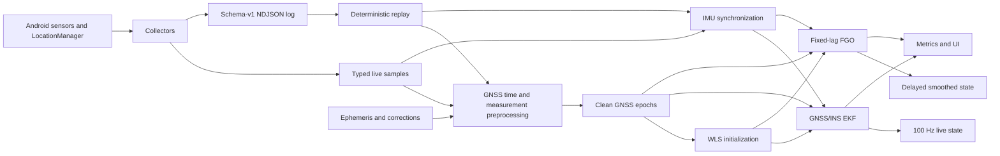

# Architecture

## Objective

NavGraph is an Android GNSS/INS research prototype for a Samsung Galaxy S23+.
The target architecture publishes a low-latency inertial/EKF navigation state at
up to 100 Hz while an asynchronous fixed-lag optimizer produces delayed smoothing
corrections. Raw GNSS availability, rate, carrier continuity, accuracy, battery,
and thermal behavior must be measured on the physical device.

The project does not define "100 Hz" as 100 independent GNSS fixes or 100 graph
optimizations per second. It means 100 Hz IMU-propagated output, corrected at the
actual GNSS rate and optionally smoothed at a lower graph rate.

## System context

Collectors now publish immutable typed samples to both the logger and a bounded
live worker queue. The worker reconstructs GNSS receive/transmit time, applies
quality checks, queries typed ephemeris/correction providers, tracks clock arcs,
and exposes rejection telemetry. App 0.12.0 ingests GPS L1 C/A broadcast subframes
and can produce live GPS L1 satellite states after a consistent ephemeris is
assembled. Clean epochs feed warm-start WLS and a monotonic-time GNSS/INS EKF;
an independent single worker runs the two-second inertial fixed-lag smoother.
Multi-constellation ephemeris remains a target boundary.

## Modules

### Android collection

`logging/LoggingService.kt` owns the foreground session lifecycle. It starts:

- `GnssRawCollector` for one clock record and N raw measurement records per GNSS
  callback, requesting full tracking on Android 12 and later;
- `GnssNavigationMessageCollector` for exact Base64-preserved navigation-message
  payloads and typed decoder dispatch;
- `ImuCollector` for accelerometer and gyroscope samples at a requested 10,000 us
  period with zero batching latency;
- `FusedLocationCollector` for enabled `fused`, `gps`, and `network` providers;
- `NdjsonLogWriter` for synchronized UTF-8 NDJSON output.

Each callback also offers one typed event to `LiveEstimatorCoordinator`. The offer
is nonblocking; a full queue increments a drop counter visible in diagnostics.
JSON and Android framework objects do not cross the estimator boundary.

`MainActivity` owns runtime permission flow and sends explicit start, stop, and
query actions. Collection continues in the foreground service when the activity is
not visible.

### Logging and replay

Each session is a self-describing schema-v1 NDJSON file. Records preserve source
timestamps and callback timestamps so queueing latency and time alignment can be
measured. `docs/log_schema.md` is the authoritative field contract.

The on-device `AssetReplayEstimator` processes the bundled GSDC-derived fixtures
and a deterministic synthetic GNSS/INS scenario. Desktop tools under
`../validation_tools` provide a separate implementation for regression comparison,
strict NDJSON validation, and raw device-log replay. `navgraph_replay.py` sorts
streams by monotonic source time, reconstructs exact GNSS callback epochs and
clock arcs, consumes only already-received navigation messages/fused fixes,
preprocesses GPS L1 C/A observations, and dispatches clean epochs to the shared
desktop WLS/FGO implementation. It exports clean observations, IMU, fused fixes,
solutions, metrics, and an ENU trajectory plot.

### GNSS preprocessing

Preprocessing converts raw or derived rows into `GnssEpoch` objects containing
corrected pseudorange/range-rate observations and satellite ECEF states. It owns:

- GNSS receive/transmit-time construction and constellation time rollover;
- hardware clock discontinuity partitioning;
- ephemeris lookup and satellite position, velocity, and clock evaluation;
- Earth-rotation, satellite clock, ionosphere, troposphere, and inter-signal
  corrections;
- constellation, signal, state, uncertainty, C/N0, and elevation checks;
- stable rejection reason counts.

The current GSDC replay consumes derived satellite states/corrections already in
CSV. `RawGnssPreprocessor` implements Android GPS, QZSS, Galileo, and BeiDou
week/TOW construction, stable quality rejections, satellite/correction lookup,
and clean-epoch assembly. `GpsL1CaEphemerisProvider` accepts parity-passed or
rebuilt Android GPS L1 C/A subframes 1-3, requires matching IODC/IODE, evaluates
the IS-GPS-200 broadcast orbit and satellite clock, applies a four-hour freshness
limit, and exposes URA as observation uncertainty. Other signals return explicit
unsupported/unavailable results. `SnapshotSatelliteStateProvider` remains the
deterministic frozen-state test provider.

### Estimator core

- `GnssWlsSolver` estimates ECEF position/velocity and receiver clock bias/drift,
  using robust pseudorange and Doppler least squares.
- `ImuMechanization` propagates local ENU position, velocity, body-to-ENU attitude,
  inertial biases, and receiver clock state from monotonic IMU samples.
- `GnssInsEkf` uses a 17-element local error state and sequential pseudorange and
  Doppler corrections with innovation gates and Joseph covariance updates.
- `InertialFixedLagSmoother` optimizes a two-second window of position, velocity,
  accelerometer bias, clock bias, and clock drift with robust GNSS and translational
  preintegration factors.

The fixed-lag graph does not yet optimize attitude or gyroscope bias. Those states
exist in the EKF. Dependency-free C++17 implements GNSS geometry, robust
pseudorange/Doppler WLS, quaternion operations, full nominal INS mechanization, and
the complete 17-state EKF covariance/GNSS step. The JNI adapter has deterministic
host parity coverage and is packaged by default for arm64 with pinned NDK/CMake
versions. The fixed-lag backend is a dependency-free damped dense Gauss-Newton solve;
the two-second live lag bounds its matrix to three 11-state keyframes at the expected
1 Hz GNSS rate. Android instrumentation proves library loading, 21 native live WLS
updates, 2,000 native EKF/INS propagation steps, 21 native GNSS corrections, 44
native graph-window solves, asynchronous FGO publication, and accepted gated
feedback with zero native fallback;
`-Pnavgraph.enableNative=false` is the deliberate toolchain-free fallback.

`KotlinLiveEstimatorBackend` is the active reference backend. For each clean GNSS
epoch it first attempts the optional JNI WLS implementation and accepts only a
finite converged result; a missing library or numerical failure uses Kotlin WLS,
with engine and fallback counters exposed in diagnostics. It pairs independent
accelerometer and gyroscope callbacks within a 20 ms bound, holds combined samples
for 100 ms to absorb cross-thread callback reordering, and splits an IMU interval
at the exact GNSS elapsed-realtime timestamp before applying an EKF update. WLS
initializes ECEF position/clock and the ENU origin; measured specific force aligns
roll/pitch to local up while yaw remains unobservable without another heading
source. Each high-rate filter step attempts the C++ nominal and sparse covariance
propagation together; each GNSS epoch attempts the C++ sequential pseudorange and
Doppler Joseph update. Typed status, timestamp, finite-state, covariance symmetry,
and nonnegative-diagonal gates trigger a Kotlin fallback and visible subsystem
health counters. The fallback covariance path can still use the standalone native
nominal mechanization before falling back fully to Kotlin. EKF output is
authoritative. FGO executes asynchronously over copied two-second histories. Each
window attempts native robust graph optimization and selected inverse-Hessian
marginals; a typed, dimensional, finite, or solver failure runs the Kotlin reference
and increments visible fallback telemetry. It publishes a delayed solution with
marginal covariance derived from the final robust graph Hessian. A same-keyframe correction is
accepted only when the graph converged, covariance is finite, solution age is at
most two seconds, absolute position, velocity, and clock bounds pass, and a
correlation-inflated normalized innovation gate passes. Accepted translation and
clock deltas use a conservative 0.25 gain and do not reduce EKF covariance because
both pipelines reuse the same measurements.

### Presentation

The UI has live, replay, and diagnostics views. It displays collector health,
record counts, clock discontinuities, computed replay metrics, trajectories,
solver failures, rejections, covariance summaries, and Jacobian errors. UI code
does not participate in estimation.

## Frame contract

- LLA uses WGS84 latitude degrees, longitude degrees, and ellipsoidal height meters.
- Absolute receiver and satellite position/velocity use ECEF meters and ECEF m/s.
- Inertial states use an ENU tangent frame at an immutable ECEF reference origin.
- Android sensor axes form body frame B. `attitudeBodyToEnu` maps B vectors to ENU.
- Accelerometer input is specific force. The mechanization adds ENU gravity
  `[0, 0, -9.80665]` m/s2 after rotating specific force into ENU.
- Range derivatives are formed in ECEF and explicitly mapped into ENU for the EKF
  and inertial graph.

## Time contract

Four different notions of time are deliberately kept separate:

| Time | Source | Use |
|---|---|---|
| Event monotonic time | sensor, GNSS clock, or location elapsed realtime | ordering, synchronization, IMU integration |
| Callback monotonic time | `SystemClock.elapsedRealtimeNanos()` | collection latency diagnostics |
| GNSS receiver time | `GnssClock` plus measurement transmit time | pseudorange preparation and ephemeris lookup |
| Wall/UTC time | system/location milliseconds | filenames, display, external dataset alignment |

IMU timestamps must increase. GNSS correction requires the epoch and propagated
INS state to agree within 1 ms on `elapsedRealtimeNanos`. Absolute GPS milliseconds
remain attached for ephemeris and external output, but are never compared to the
monotonic INS clock. A change in
`hardware_clock_discontinuity_count` starts a new clock-continuity segment.

## Runtime model

- IMU callbacks run on a dedicated `HandlerThread`.
- GNSS callbacks run on a single-thread executor.
- Location callbacks run on a dedicated `HandlerThread`.
- NDJSON writes are synchronized; callback work never mutates estimator state.
- Typed events enter a bounded 4,096-event queue and are consumed by one live
  estimator worker; overflow and consumer failures are counted.
- Replay runs on a single background executor and posts immutable results to UI.
- Target live EKF propagation is 100 Hz. GNSS correction follows measured raw GNSS
  epochs, commonly 1 Hz until proven otherwise. Target FGO publication is 1-5 Hz
  over a two-second lag; UI rendering should remain 10-30 Hz.

## Reliability boundaries

- Android sampling periods are requests, not guarantees. Measure actual rate,
  jitter, batching, and callback delay.
- `fullTracking` is requested where available, but firmware may ignore or limit it.
- Optional GNSS fields are omitted from logs when unavailable.
- Emulator GNSS is synthetic and cannot validate S23+ RF behavior.
- The bundled public fixture is too short to support accuracy claims.
- Synthetic improvements validate code behavior only.
- FGO feedback gates and 0.25 gain are conservative prototype defaults. They must
  be consistency-tested and tuned without ground-truth leakage on physical-device
  logs before feedback can be considered production-safe.

## Broadcast ephemeris references

The GPS L1 C/A decoder and orbit evaluator were checked against:

- Android's `GnssNavigationMessage` byte/word and submessage contract:
  <https://developer.android.com/reference/android/location/GnssNavigationMessage>;
- the official IS-GPS-200N navigation data and user equations:
  <https://archive.gps.gov/technical/icwg/IS-GPS-200N.pdf>;
- Google GNSS Measurement Tools commit `063e2275`, Apache-2.0 reference decoder,
  satellite position, and clock implementations:
  <https://github.com/google/gps-measurement-tools/tree/063e2275e29de1f5476f2a9a9e0cb900a37d0b68>.

NavGraph uses its own dependency-free Kotlin implementation and does not vendor
the upstream Java/protobuf code.
